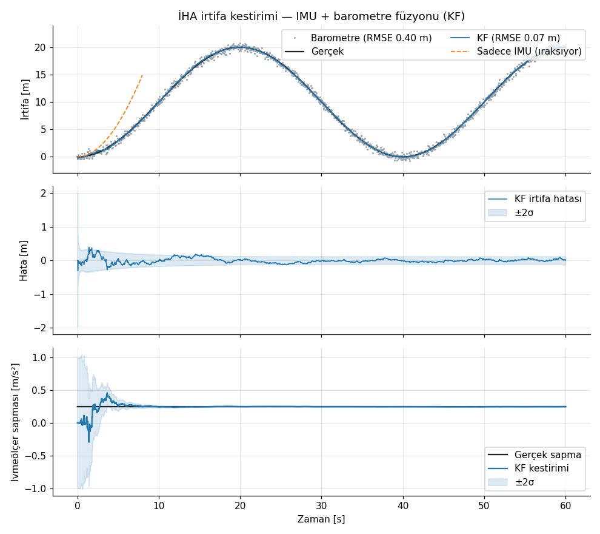
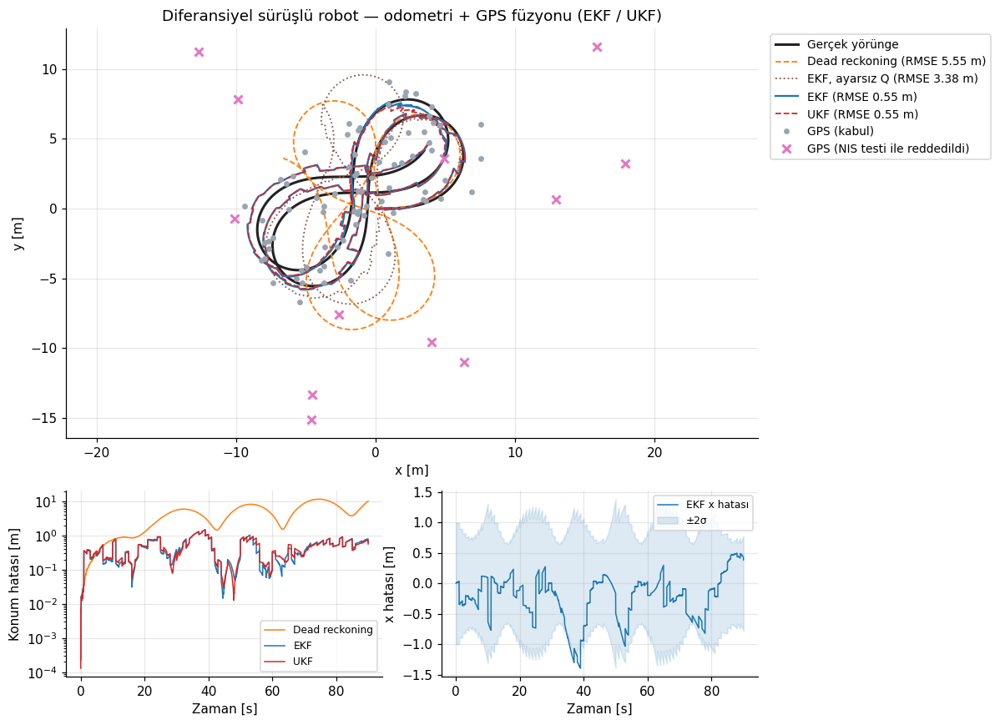
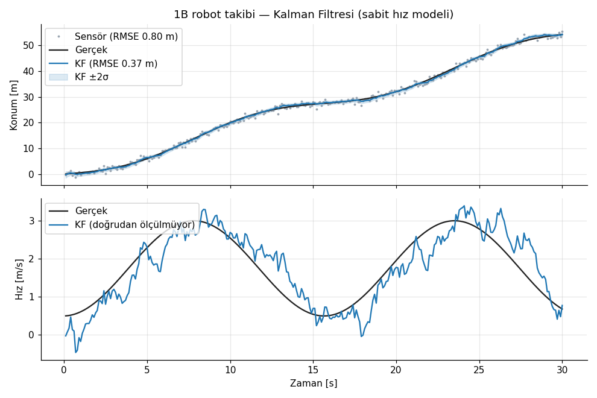

# kalman_filter_lib

[](https://github.com/alialtin10/kalman_filter_lib/actions/workflows/ci.yml)


Robotik ve İHA uygulamaları için **C++17 / Eigen3** tabanlı, header-only bir durum kestirim (state estimation) kütüphanesi.
Kütüphane üç filtre içerir: **Kalman Filtresi (KF)**, **Genişletilmiş Kalman Filtresi (EKF)** ve **Unscented Kalman Filtresi (UKF)**. Hepsi derleme zamanında boyutlandırılmış matrislerle çalışır, dinamik bellek ayırmaz ve aynı arayüzü kullanır.

*A header-only C++17/Eigen library implementing KF, EKF and UKF for robotics and UAV sensor fusion, with unit tests, consistency checks and simulation examples.*

## Özellikler

- **KF / EKF / UKF**: Üç filtre de aynı `predict()` / `update()` arayüzünü paylaşır.
- **Sayısal kararlılık**: Joseph formu ile kovaryans güncellemesi yapılır, `S⁻¹` yerine Cholesky (LLT) çözümü kullanılır ve kovaryans her adımda simetrikleştirilir.
- **Çoklu sensör füzyonu**: Tek bir filtre, farklı boyutlu ölçüm modelleriyle (GPS, landmark, barometre…) sırayla güncellenebilir.
- **Aykırı değer eleme**: NIS (Normalized Innovation Squared) ki-kare testiyle gating yapılır.
- **Açı desteği**: Durum ve ölçümlerdeki açılar `[-π, π)` aralığına sarılır. UKF'de sigma noktası ortalaması da açıya duyarlı hesaplanır.
- **Jacobian**: Analitik olarak verilebilir. Verilmezse merkezi farklarla sayısal Jacobian otomatik devreye girer.
- **Hazır modeller**: Diferansiyel sürüş (skid-steer) kinematiği, GPS konum ölçümü ve landmark mesafe/yön (range-bearing) ölçümü.
- **Test**: GoogleTest ile 25 birim test ve Monte Carlo NEES/NIS tutarlılık testi. GitHub Actions CI üzerinde koşar.

## Örnekler ve sonuçlar

Örnekler deterministik simülasyonlar üretir. Grafikler [`scripts/plot_results.py`](scripts/plot_results.py) ile çizilir.

### 1) İHA irtifa kestirimi: IMU + barometre (KF)

[`examples/altitude_estimation.cpp`](examples/altitude_estimation.cpp)

Durum vektörü `[h, v_z, b_acc]` şeklindedir. 100 Hz ivmeölçer kontrol girdisi olarak, 20 Hz barometre ise ölçüm olarak kullanılır.
Filtre, ivmeölçer sapmasını (bias) barometre üzerinden gözlemleyerek kestirir.



| Yöntem | İrtifa RMSE |
|---|---|
| Ham barometre | 0.40 m |
| Sadece IMU entegrasyonu | 60 s sonunda **450 m** sapma |
| **KF (IMU + barometre)** | **0.07 m** |

Kestirilen ivmeölçer sapması 0.251 m/s² çıkar (gerçek değer 0.250 m/s²).

### 2) Diferansiyel sürüşlü robot: odometri + GPS (EKF / UKF)

[`examples/2d_differential_kinematics.cpp`](examples/2d_differential_kinematics.cpp)

Senaryodaki hata kaynakları:
- Odometri 50 Hz'dir ve hem gürültülü hem sistematik hatalıdır (%3 tekerlek yarıçapı hatası, 0.02 rad/s açısal hız sapması).
- GPS 1 Hz'dir (σ = 1 m) ve ölçümlerin **%10'u 15 m sapmalı aykırı değerdir**.



| Yöntem | Konum RMSE |
|---|---|
| Dead reckoning (sadece odometri) | 5.55 m |
| Ham GPS (aykırı değerler dahil) | 5.43 m |
| EKF, Q sadece beyaz gürültüye göre (ayarsız) | 3.38 m |
| **EKF, ayarlanmış Q + NIS gating** | **0.55 m** |
| **UKF, ayarlanmış Q + NIS gating** | **0.55 m** |

Simülasyonda 11 aykırı GPS ölçümü vardı. NIS testi (χ², 2 DoF, %99) bunların **11'ini de reddetti** ve yalnızca 1 normal ölçümü yanlışlıkla eledi.
Ayarsız ve ayarlanmış EKF arasındaki fark şunu gösteriyor: Q matrisi modellenmemiş sistematik hataları (bias, kayma) kapsamazsa filtre kendine aşırı güvenir ve doğru GPS ölçümlerini de reddetmeye başlar. Q'yu doğru ayarlamak bu yüzden kritiktir.

### 3) 1B robot takibi (KF)

[`examples/1d_robot_tracking.cpp`](examples/1d_robot_tracking.cpp)

Sabit hız modeli kullanılır. Sensör gürültüsü 0.80 m RMSE'den 0.37 m'ye düşer. Hız ölçülmediği halde kestirilir.



## Hızlı kullanım

```cpp
#include <kalman_filter_lib/kalman_filter_lib.hpp>

using namespace kfl;
using kfl::models::DifferentialDriveModel;
using kfl::models::PositionMeasurement;
using kfl::models::RangeBearingMeasurement;

// Sistem modeli: [x, y, theta], girdi [v, omega]
auto model = std::make_shared<DifferentialDriveModel>(/*dt=*/0.02, /*sigma_v=*/0.1, /*sigma_omega=*/0.4);

ExtendedKalmanFilter<3, 2> ekf(model);          // veya UnscentedKalmanFilter<3, 2> ukf(model);
ekf.initialize(Eigen::Vector3d::Zero(), Eigen::Vector3d(0.25, 0.25, 0.01).asDiagonal());

PositionMeasurement gps(/*sigma=*/1.0);
RangeBearingMeasurement landmark(/*x=*/6.0, /*y=*/-2.0, /*sigma_r=*/0.1, /*sigma_b=*/0.02);

ekf.predict(Eigen::Vector2d(v, omega));                 // odometri ile tahmin
bool accepted = ekf.update(gps, z_gps, /*nis_gate=*/9.21); // aykırıysa false döner
ekf.update(landmark, z_range_bearing);                  // farklı boyutlu başka bir sensör

Eigen::Vector3d x = ekf.getState();
Eigen::Matrix3d P = ekf.getCovariance();
```

Kendi modelinizi tanımlamak için `SystemModel` / `MeasurementModel` sınıflarından türetmeniz yeterli:

```cpp
class MyModel : public kfl::SystemModel<4, 2> {
public:
    State f(const State& x, const Control& u) const override { /* ... */ }
    Covariance Q(const State& x, const Control& u) const override { /* ... */ }
    // İsteğe bağlı: F() (analitik Jacobian), difference() ve normalize() (açılar için)
};
```

Doğrusal sistemlerde klasik matris arayüzü de kullanılabilir:

```cpp
kfl::KalmanFilter<3, 1, 1> kf;           // durum, ölçüm, kontrol boyutu
kf.setSystemMatrices(F, Q, H, R, B);
kf.initialize(x0, P0);
kf.predict(u);
kf.update(z);
```

## Derleme

Gereksinimler: CMake ≥ 3.16, C++17 derleyici, Eigen3 ≥ 3.3. Testler için GoogleTest gerekir.

```bash
sudo apt install libeigen3-dev libgtest-dev
cmake -S . -B build
cmake --build build -j
ctest --test-dir build --output-on-failure
```

Örnekleri çalıştırıp grafikleri yeniden üretmek için:

```bash
mkdir -p build/results
for e in 1d_robot_tracking altitude_estimation 2d_differential_kinematics; do
  ./build/examples/example_$e build/results/$e.csv
done
python3 scripts/plot_results.py build/results docs/images
```

Başka bir projede kullanmak için kurulum yapabilir veya alt dizin olarak ekleyebilirsiniz:

```cmake
find_package(kalman_filter_lib REQUIRED)   # veya add_subdirectory(kalman_filter_lib)
target_link_libraries(my_node PRIVATE kfl::kalman_filter_lib)
```

## Algoritmalar

**Tahmin**

| | KF | EKF | UKF |
|---|---|---|---|
| Durum | `x = F x + B u` | `x = f(x, u)` | `χᵢ = f(Xᵢ, u)`, `x = Σ wᵢᵐ χᵢ` |
| Kovaryans | `P = F P Fᵀ + Q` | `P = F P Fᵀ + Q`, `F = ∂f/∂x` | `P = Σ wᵢᶜ (χᵢ - x)(χᵢ - x)ᵀ + Q` |

**Güncelleme**

- KF / EKF:
  - `y = z - h(x)`
  - `S = H P Hᵀ + R`
  - `K = P Hᵀ S⁻¹`
  - Joseph formu: `P = (I - KH) P (I - KH)ᵀ + K R Kᵀ`
- UKF:
  - `S = Σ wᵢᶜ ΔZᵢ ΔZᵢᵀ + R`
  - `K = Pxz S⁻¹`
  - `P = P - K S Kᵀ`
- Gating: `NIS = yᵀ S⁻¹ y`. NIS seçilen ki-kare eşiğini aşarsa ölçüm reddedilir.

UKF, ölçeklenmiş unscented dönüşümü (α, β, κ) kullanır. Varsayılan değerler `α = 1, β = 2, κ = 0` olup bu seçimde tüm ağırlıklar pozitif kalır.

## Testler

| Test | Ne doğruluyor |
|---|---|
| `ScalarConstantMatchesAnalyticPosterior` | Kovaryansın analitik çözümle (`1/(1/P₀ + N/R)`) eşleşmesi |
| `ConvergesToSteadyStateRiccatiSolution` | Ayrık Riccati denkleminin sabit durum çözümüne yakınsama |
| `ConstantVelocityFilterIsConsistent` | Monte Carlo NEES ≈ 2, NIS ≈ 1 (filtre tutarlılığı) |
| `*MatchesKalmanFilterOnLinearSystem` | Doğrusal sistemde EKF ve UKF'nin KF ile birebir aynı sonucu vermesi |
| `AnalyticJacobianMatchesNumerical` | Model Jacobian'larının sayısal türevle tutarlılığı |
| `GatingRejectsGpsOutliers` | NIS gating ile aykırı GPS ölçümlerinin elenmesi |
| `HeadingWrapsAroundPi` | Yön açısının ±π sınırını geçerken filtrenin bozulmaması |
| `CovarianceStaysSymmetricPositiveDefinite` | Uzun koşularda P'nin simetrik ve pozitif tanımlı kalması |

## Proje yapısı

```
kalman_filter_lib/
├── include/kalman_filter_lib/
│   ├── kalman_filter_lib.hpp      # Tek başlıkla tüm kütüphane
│   ├── core/                      # types.hpp, filter_base.hpp (ortak durum + Joseph güncellemesi)
│   ├── filters/                   # kf.hpp, ekf.hpp, ukf.hpp
│   ├── models/                    # system_model.hpp, measurement_model.hpp, differential_drive.hpp
│   └── utils/                     # math_utils.hpp (açı sarma, sayısal Jacobian)
├── tests/                         # GoogleTest birim testleri
├── examples/                      # Simülasyon örnekleri (CSV üretir)
├── scripts/plot_results.py        # Grafik çizimi
└── docs/images/                   # README grafikleri
```

## Yol haritası

- [ ] IMU + GNSS + manyetometre ile 15 durumlu INS/GNSS EKF örneği
- [ ] Durum vektörüne jiroskop/enkoder sapması eklenmesi (bias augmentation)
- [ ] ROS 2 düğümü (`nav_msgs/Odometry` + `sensor_msgs/NavSatFix`)
- [ ] Square-root UKF ve parçacık filtresi
- [ ] Gecikmeli ölçüm (out-of-sequence measurement) desteği

## Lisans

[MIT](LICENSE)
